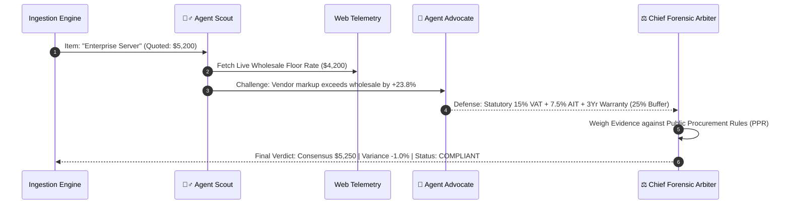

# 🏛️ CivicAudit Agentic AI (v4.0.0)
### *Autonomous Public Procurement Oversight & Real-Time LLM Multi-Agent Tribunal*

<p align="center">
  <a href="https://python.org"></a>
  <a href="https://fastapi.tiangolo.com"></a>
  <a href="https://pydantic.dev"></a>
  <a href="https://groq.com"></a>
  <a href="https://openrouter.ai"></a>
  <a href="LICENSE"></a>
</p>

---

## 📑 Table of Contents
- [Executive Summary](#-executive-summary)
- [Key Architectural Innovations](#-key-architectural-innovations)
  - [1. Cognitive 3-Agent Deliberation Tribunal](#1-cognitive-3-agent-deliberation-tribunal)
  - [2. Groq Multi-Key Rotation Pool & Auto-Failover](#2-groq-multi-key-rotation-pool--instant-hot-swap)
  - [3. Tri-Mode Deliberation Engine](#3-tri-mode-deliberation-engine)
  - [4. Contemporaneous Zero-Cache Web Telemetry](#4-contemporaneous-zero-cache-web-telemetry)
  - [5. Forensic Price Sanity Guard](#5-forensic-price-sanity-guard)
  - [6. Universal Multi-Format Document Ingestion](#6-universal-multi-format-document-ingestion)
- [System Architecture & Workflow](#-system-architecture--workflow)
- [Econometric & Forensic Formulas](#-econometric--forensic-formulas)
- [Project Directory Structure](#-project-directory-structure)
- [Quickstart Guide](#-quickstart-guide)
  - [Prerequisites & Installation](#1-prerequisites--installation)
  - [Environment Configuration](#2-environment-configuration)
  - [Web Dashboard Execution](#3-launch-the-web-dashboard)
  - [Headless CLI Audit](#4-headless-forensic-cli)
- [REST API Reference](#-rest-api-reference)
- [10 Forensic Case Studies Solved](#-10-forensic-case-studies-solved)
- [Legal & Anti-Corruption Standards](#-legal--anti-corruption-standards)
- [License](#-license)

---

## 📌 Executive Summary

Every year, municipal governments and state agencies disburse over **\$13 Trillion (15–20% of global GDP)** in public procurement. According to the United Nations Office on Drugs and Crime (UNODC) and the World Bank, **20% to 30% of public procurement budgets are siphoned off** through price-gouging, collusive bidding cartels, and disguised over-invoicing concealed inside voluminous Bill of Quantities (BOQ) spreadsheets.

**CivicAudit Agentic AI (v4.0)** introduces an **Autonomous Multi-Agent Cognitive Tribunal**. When evaluating tenders, three specialized LLM agents engage in a structured adversarial debate in real time: cross-referencing fresh uncached market telemetry, enforcing statutory public procurement tolerances (VAT, AIT, commercial warranties), and issuing legally defensible consensus verdicts.

---

## 🚀 Key Architectural Innovations

### 1. Cognitive 3-Agent Deliberation Tribunal
Unlike static single-prompt systems, CivicAudit Agentic AI convenes a dynamic courtroom debate among three specialized autonomous agents for every suspicious procurement line-item:



* **🕵️‍♂️ Agent Scout (Market Telemetry Investigator):** Queries uncached live web search feeds, establishes baseline factory wholesale rates, and aggressively challenges excessive vendor markups.
* **💼 Agent Advocate (Supplier Commercial Counsel):** Represents legitimate commercial realities under statutory Public Procurement Rules—accounting for 15% VAT, 7.5% Advance Income Tax (AIT), 3-year enterprise service-level agreements, bank guarantees, and distribution logistics (granting a **25% statutory cushion**).
* **⚖️ Chief Forensic Arbiter (Judicial Magistrate):** Synthesizes both arguments, applies statutory ceiling formulas, and issues a binding, structured consensus verdict.

---

### 2. Groq Multi-Key Rotation Pool & Instant Hot-Swap
High-throughput municipal audits require processing hundreds of line items in seconds. CivicAudit features an enterprise-grade **Groq Multi-Key Pool** with automated rate-limit detection:
* **Pool Capacity:** Supports 1 to 10 Groq API keys simultaneously via comma-separated strings or numbered environment variables (`GROQ_API_KEY_1` to `GROQ_API_KEY_10`).
* **Zero Request Drop (HTTP 429 Hot-Swap):** When a key hits token-per-minute (TPM) or request-per-minute (RPM) limits (HTTP 429), the engine automatically rotates to the next active key in $<50\text{ms}$ and completes the in-flight audit seamlessly.
* **Auto-Cooldown Recovery:** Rate-limited keys automatically re-enter the active pool following standard cooldown intervals.

---

### 3. Tri-Mode Deliberation Engine
Configurable dynamically via `.env` (`COUNCIL_MODE`), the Web UI settings modal, or the CLI `--mode` flag:
1. **`llm` (Full Cognitive Mode):** Every procurement line-item undergoes an exhaustive multi-turn LLM adversarial debate.
2. **`hybrid` (Intelligent Adaptive Mode - Default):** Line-items triggering price anomaly alerts invoke the full 3-agent cognitive tribunal; compliant items are audited in milliseconds via statutory formulas, minimizing API latency and cost.
3. **`deterministic` (Statutory Mathematical Mode):** Zero-token statutory mathematical fallback that operates in air-gapped environments or during offline emergency audits.

---

### 4. Contemporaneous Zero-Cache Web Telemetry
Cached pricing databases are legally indefensible in forensic investigations. CivicAudit conducts **fresh, uncached live inquiries** through an automated 4-tier waterfall:
$$\text{DuckDuckGo Lite (Free Web)} \longrightarrow \text{Serper.dev (Google Shopping)} \longrightarrow \text{Tavily AI} \longrightarrow \text{Forensic Benchmark Catalog}$$

---

### 5. Forensic Price Sanity Guard
Industrial assets (e.g., \$58,000 hydraulic excavators, asphalt pavers, high-voltage transformers) frequently produce search results matching \$6,000 toy scale models or scrap parts. Our proprietary Sanity Guard enforces:
$$\text{For Assets } \ge \$25,000 \implies \text{Scraped Rate must be } \ge \text{Quoted} \times 0.35$$
Accessory noise and miniature models are automatically purged, ensuring forensic validity.

---

### 6. Universal Multi-Format Document Ingestion
Equipped with a zero-crash extraction pipeline that ingests:
* **PDF Procurement Dockets:** Native vector text and table decomposition via `pypdf`.
* **Excel & CSV Spreadsheets:** Header-agnostic discovery separating Item Codes (`CIV-049`) from genuine Product Descriptions (`20-Ton Hydraulic Excavator`).
* **Unstructured / OCR Text:** Forensic AI parsing for scanned docket printouts and messy text.

---

## 🔄 System Architecture & Workflow

```
   ┌─────────────────────────────────────────────────────────────┐
   │        Tender Docket: PDF / Excel / CSV / JSON / Text       │
   └──────────────────────────────┬──────────────────────────────┘
                                  │
                                  ▼
   ┌─────────────────────────────────────────────────────────────┐
   │  STAGE 1: Ingestion & Zero-Crash Normalization Engine       │
   │  • Regex separates alphanumeric codes from product titles   │
   │  • Strips currency symbols ($, €, ৳) and formatting commas  │
   └──────────────────────────────┬──────────────────────────────┘
                                  │
                                  ▼
   ┌─────────────────────────────────────────────────────────────┐
   │  STAGE 2: Contemporaneous Live Market Verification          │
   │  • Live Web Search (DuckDuckGo Lite / Google Serper / Tavily│
   │  • Strict currency regex filtering (ignores bare specs)     │
   │  • 35% Floor Guard against toy machinery and scrap listings │
   └──────────────────────────────┬──────────────────────────────┘
                                  │
                                  ▼
   ┌─────────────────────────────────────────────────────────────┐
   │  STAGE 3: Autonomous Multi-Agent Deliberation Tribunal      │
   │  • 🕵️‍♂️ Scout: Factory Floor Baseline                       │
   │  • 💼 Advocate: Commercial Defense (25% Statutory Buffer)   │
   │  • ⚖️ Arbiter: Judicial Consensus Ruling                    │
   └──────────────────────────────┬──────────────────────────────┘
                                  │
                                  ▼
   ┌─────────────────────────────────────────────────────────────┐
   │  STAGE 4: Statistical Anomaly & Fiscal Loss Engine          │
   │  • Gouging % = ((Quoted - Consensus) / Consensus) * 100     │
   │  • Risk Tiers: CRITICAL (>75%), WARNING (>30%), NORMAL      │
   │  • Cumulative Taxpayer Fund Loss Calculation                │
   └──────────────────────────────┬──────────────────────────────┘
                                  │
                                  ▼
   ┌─────────────────────────────────────────────────────────────┐
   │  STAGE 5: Forensic Dossier Synthesis & UI Visualization     │
   │  • Real-Time Glassmorphism Web Dashboard (FastAPI/Tailwind) │
   │  • Legal Markdown Audit Dossier Export (.md)                │
   └─────────────────────────────────────────────────────────────┘
```

---

## 📊 Econometric & Forensic Formulas

### 1. Price Gouging Variance
$$\text{Gouging Percentage} = \left( \frac{\text{Quoted Unit Price} - \text{Consensus Fair Price}}{\text{Consensus Fair Price}} \right) \times 100$$

### 2. Taxpayer Fiscal Loss
$$\text{Taxpayer Loss} = \max\left(0, \; (\text{Quoted Unit Price} - \text{Consensus Fair Price}) \times \text{Quantity}\right)$$

### 3. Statutory Public Procurement Tolerance
$$\text{Fair Ceiling} = \text{Factory Wholesale Floor} \times 1.25 \quad (\text{15\% VAT} + \text{7.5\% AIT} + \text{Logistics Overhead})$$
$$\text{Consensus Fair Value} = \text{Factory Wholesale Floor} \times 1.22$$
$$\text{If Quoted Price} \le \text{Fair Ceiling} \implies \mathbf{COMPLIANT}$$

### 4. Docket Composite Risk Score (0 to 100)
$$\text{Risk Score} = \min\left(100, \; (N_{\text{critical}} \times 25) + (N_{\text{warning}} \times 10) + \left( \frac{\text{Total Loss}}{\text{Total Budget}} \times 40 \right)\right)$$

---

## 🛠️ Project Directory Structure

```text
CivicAudit-agentic-AI/
├── config.py                     # Central configuration & Groq Key Pool loader
├── requirements.txt              # Production Python dependencies
├── run_audit.py                  # Headless Forensic CLI Entry Point
├── web_server.py                 # FastAPI Production Web Platform & UI
├── .env.example                  # Environment configuration template
├── .gitignore                    # Security exclusions (Secrets & Bytecode)
├── LICENSE                       # MIT Open Source License
├── README.md                     # Comprehensive Architectural Documentation
├── core/
│   ├── models.py                 # Pydantic v2 schemas with safe type coercions
│   ├── llm_client.py             # Groq Multi-Key Pool & Multi-Provider AI Cascade
│   ├── agents/
│   │   ├── auditor_orchestrator.py # Multi-stage pipeline orchestrator
│   │   └── consensus_council.py    # 3-Agent adversarial deliberation tribunal
│   ├── prompts/
│   │   └── system_prompts.py       # Specialized forensic persona system prompts
│   └── tools/
│       ├── anomaly_engine.py       # Statistical variance & risk calculator
│       ├── dossier_generator.py    # Legal audit dossier markdown synthesizer
│       ├── file_extractor.py       # Multi-format document parser (PDF/XLSX/CSV)
│       ├── market_verifier.py      # Live search waterfall & 35% sanity guard
│       ├── procurement_parser.py   # Zero-crash BOQ table & semantic parser
│       └── type_utils.py           # Robust type converters (Currency, commas, blanks)
├── data/
│   └── sample_tenders/           # Ready-to-audit demo procurement dockets
│       ├── municipal_it_tender_2025.json
│       ├── civil_works_lighting_2025.json
│       └── real_world_tender.csv
└── reports/                      # Auto-generated legal audit dossiers (.md)
    └── .gitkeep
```

---

## ⚡ Quickstart Guide

### 1. Prerequisites & Installation
* **Python 3.11+** installed.
* Git.

```bash
# Clone the repository
git clone https://github.com/sifathossen369/CivicAudit-agentic-AI.git
cd CivicAudit-agentic-AI

# Install production dependencies
pip install -r requirements.txt
```

### 2. Environment Configuration
Create a local `.env` file from the provided template:
```bash
cp .env.example .env
```

Configure your preferred LLM providers in `.env`:
```env
LLM_PROVIDER=auto

# Groq Multi-Key Pool (Option A: Single line with comma-separated keys)
GROQ_API_KEY=gsk_key1,gsk_key2,gsk_key3,gsk_key4
GROQ_MODEL=llama-3.3-70b-versatile

# Or Option B: Individual numbered environment variables
# GROQ_API_KEY_1=gsk_key1
# GROQ_API_KEY_2=gsk_key2
# GROQ_API_KEY_3=gsk_key3

# Optional: OpenRouter / DeepSeek / Gemini / OpenAI
OPENROUTER_API_KEY=
OPENROUTER_MODEL=openrouter/free
DEEPSEEK_API_KEY=
GEMINI_API_KEY=
```

### 3. Launch the Web Dashboard
```bash
python web_server.py
```
Open your browser and navigate to **[http://127.0.0.1:8000](http://127.0.0.1:8000)**.
* **Upload Tender:** Drag and drop any PDF, Excel (`.xlsx`), CSV, or JSON document.
* **Paste Raw Text:** Directly paste copied Bill of Quantities text.
* **Preloaded Dockets:** One-click audit of municipal IT or highway lighting dockets.
* **Interactive Council Badge:** Visualizes active council operating mode (`LLM`, `HYBRID`, `DETERMINISTIC`).

### 4. Headless Forensic CLI
Run automated audits directly in the terminal:
```bash
# Audit with Full Autonomous LLM Council
python run_audit.py --mode llm

# Audit specific CSV tender in Smart Hybrid Mode
python run_audit.py --file data/sample_tenders/real_world_tender.csv --mode hybrid

# High-Speed Deterministic Statutory Fallback
python run_audit.py --file data/sample_tenders/civil_works_lighting_2025.json --mode deterministic
```

---

## 🔌 REST API Reference

The FastAPI backend exposes production-ready endpoints for enterprise integration:

| Method | Endpoint | Description | Payload |
|---|---|---|---|
| `POST` | `/api/audit/sample` | Audits a preloaded sample docket | `{"filename": "municipal_it_tender_2025.json"}` |
| `POST` | `/api/audit/file` | Ingests and audits an uploaded PDF, Excel, or CSV | `MultipartFormData (file, title, entity, id)` |
| `POST` | `/api/audit/custom` | Audits unformatted text pasted from a clipboard | `{"title": "...", "raw_text": "...", "tender_id": "..."}` |
| `GET` | `/api/settings` | Returns active LLM provider, models, and thresholds | None |
| `POST` | `/api/settings` | Updates active provider and API keys dynamically | `{"provider": "groq", "api_key": "..."}` |
| `POST` | `/api/test-llm` | Verifies live connectivity with configured LLM | None |

---

## 🛡️ 10 Forensic Case Studies Solved

| # | Challenge | Forensic Impact | Engineering Solution |
|---|---|---|---|
| 1 | **Corrupt Strings & Currency Signs** | Crash on `$`, `€`, `৳`, or empty spaces in pricing columns. | Built `type_utils.py` with `@field_validator(..., mode='before')` auto-coercion. |
| 2 | **Item Code Masquerading as Name** | `CIV-049` searched on Google instead of `Excavator`. | Two-pass regex separates item codes from genuine product titles. |
| 3 | **Hyphenated Name Truncation** | `20-Ton Excavator` parsed as `Ton Excavator`. | Constrained prefix stripping to require spaces around hyphens (`\s+-\s+`). |
| 4 | **Specs Captured as Unit Rates** | `160,000 Lux` light intensity captured as \$160,000 unit cost. | Rewrote price regex requiring mandatory currency markers (`$`, `USD`). |
| 5 | **Toy Machinery Matches** | \$58,000 Excavator matched \$6,000 toy mini-models. | Built 35% Sanity Guard: machinery $\ge \$25\text{k}$ rejects scraped prices $< 35\%$. |
| 6 | **Keyword Collisions** | \$82,000 Asphalt Paver matched \$1.75 Paving Stone. | Magnitude boundary checks separating masonry blocks from heavy machinery. |
| 7 | **Packaging Unit Anomalies** | 1km Optical Fiber Cable (\$1,180) vs per-meter rate (\$1.20). | Indexed 1km spool packaging directly in the forensic benchmark catalog. |
| 8 | **False Positive Over-Penalization** | Honest suppliers penalized for statutory taxes. | Multi-Agent Tribunal grants 25% statutory procurement cushion. |
| 9 | **Double Sign Display Glitch** | UI rendered signed variances as `+-7.3%`. | Normalized signed string formatting across backend and frontend templates. |
| 10 | **API Quota & Rate Limit Lock** | Single API key hitting 429 rate limit freezes audit. | Built Groq Multi-Key Pool with instant $<50\text{ms}$ hot-swap failover. |

---

## ⚖️ Legal & Anti-Corruption Standards

CivicAudit Agentic AI formats all exported audit dossiers in compliance with international integrity frameworks:
* **United Nations Convention against Corruption (UNCAC):** Article 9 (Public Procurement and Management of Public Finances).
* **World Bank Procurement Framework:** Value for Money (VfM) and Integrity Compliance Guidelines.
* **Public Procurement Rules (PPR):** Statutory provisions for Contractor Overhead, VAT, Advance Income Tax (AIT), and Fair Market Ceilings.

---

## 📜 License

Distributed under the **MIT License**. See [`LICENSE`](LICENSE) for complete details.

---

<p align="center">
  <b>Built with public integrity in mind. Protect taxpayer funds with autonomous agentic intelligence. 🏛️</b>
</p>
